# Multi-feature Variable Sequence Prediction (7) CEEMDAN+Transformer-BiLSTM Prediction Model

Single-variable includes the following content:
Including wind speed data, as well as a pre-generated dataset and label set for wind speed, all of which can be run.
CEEMDAN+Transformer-BiLSTM model, with smaller MSE, MAE, and significant improvement in performance!
Including data preprocessing code and CEEMDAN decomposition code, as well as complete CEEMDAN+Transformer-BiLSTM model prediction code, visualization code.
The lowest price on the network, the best tutorial for multi-feature variable sequence prediction, with high model innovation, everyone can understand:
Preface
This article introduces a multi-feature variable sequence prediction model CEEMDAN + Transformer-BiLSTM based on the previously introduced wind speed data (attached at the end to the dataset), aiming to improve the predictive performance of time series data.
Overall model structure: The dataset consists of nine variables including weather, temperature, humidity, pressure, and wind speed, using the CEEMDAN algorithm to decompose the wind speed sequence. Then, all components are combined with the original dataset variables to form an enhanced feature input, creating a sliding window dataset to predict wind speed using multiple variables. Transformer-BiLSTM is used to extract the enhanced features, which are then fed into a fully connected layer to achieve a high-precision prediction model.
1 Multi-feature Variable Data Set Production and Preprocessing
1.1 Importing Data
1.2 CEEMDAN Decomposition
1.3 Data Set Production and Preprocessing
Firstly, combine the original data variables and the decomposed components, dividing the training set and test set at a ratio of 9:1
Make datasets
2 Pytorch-based CEEMDAN + Transformer-BiLSTM Prediction Model
2.1 Define CEEMDAN + Transformer-BiLSTM prediction model
\tNote: The input wind speed data has a shape of [256, 24, 23]. Batch_size=256, where 24 represents the sequence length (the sliding window takes values), and the dimension of 23 dimensions represents the dimension of 8 variables and 15 components.
\t  
\tWhen using the multi-head attention in the Transformer model, the input dimension must be divisible by num_heads (the number of attention heads). In the multi-head attention mechanism, the input embedding vector is divided into multiple heads, with each head having a dimension of embed_dim / num_heads. Therefore, embed_dim must be divisible by num_heads to ensure that it can be evenly distributed to each attention head.
\tSince there are now 23 input features, this paper adopts a half-split stacking method to make the input shape [256, 12, 46].
\t2.2 Set parameters and train the model
\t50 epochs, MSE is 0.000298. The prediction performance of multi-variable feature CEEMDAN + Transformer-BiLSTM is good. After adding CEEMDAN decomposition, the prediction performance of multi-variables has been significantly improved, and the performance is excellent. By appropriately adjusting model parameters, the prediction performance can be further improved.
\tNote on parameter adjustments:
\tYou can increase the number of layers and dimensions in the Transformer encoder; adjust the learning rate;
\tAdjust the number of layers and dimensions per layer in the BiLSTM, increase more epochs (be cautious not to overfit);
\tChange the sliding window length (set an appropriate window length)
3 Model evaluation and visualization
\t3.1 Results visualization
\t3.2 Model evaluation
\n        \n  
\n        \n

## Images

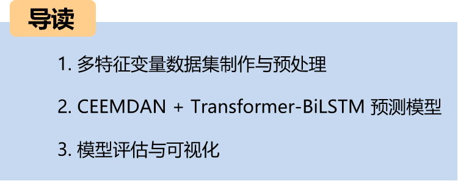
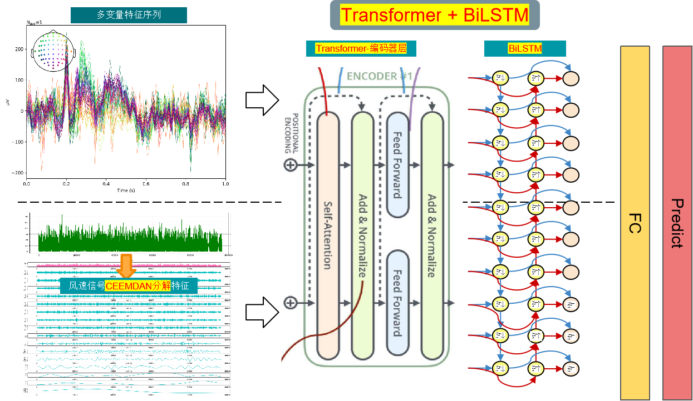

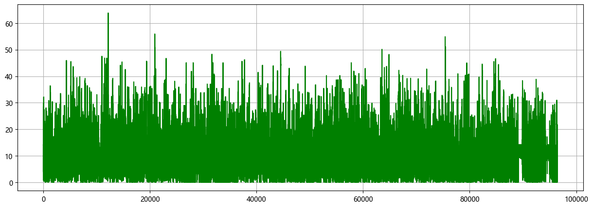

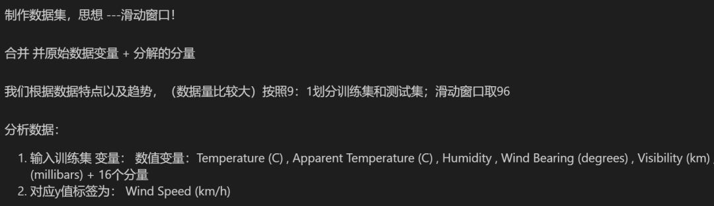

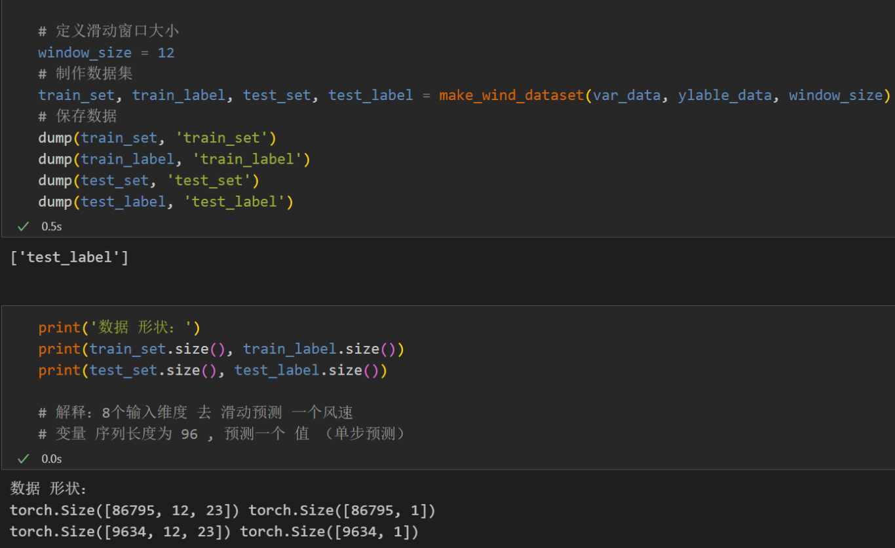
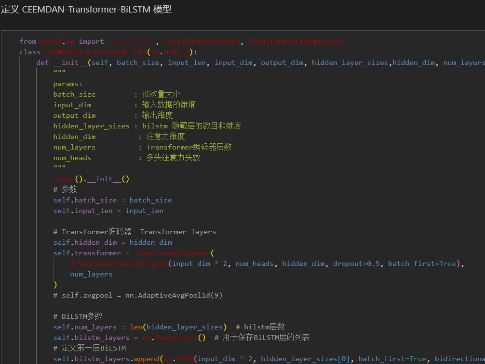
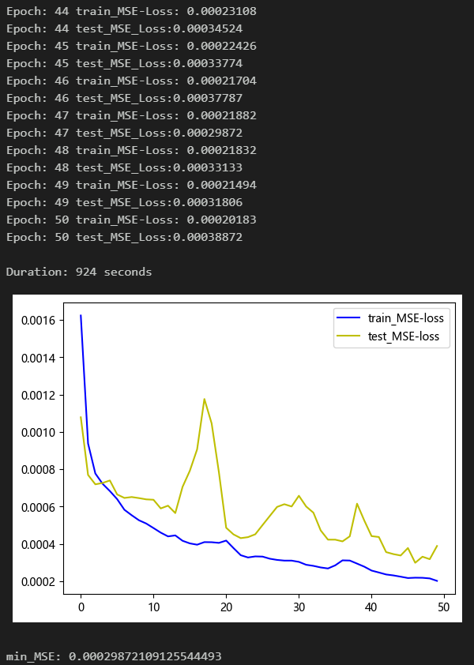
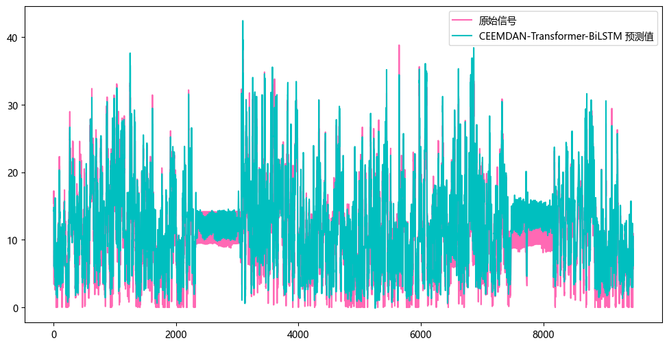
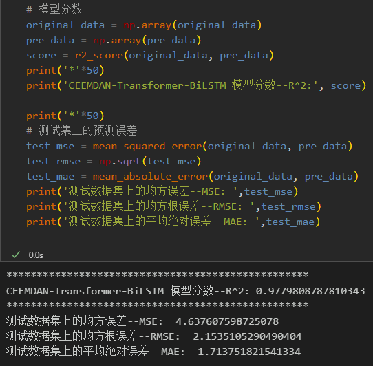
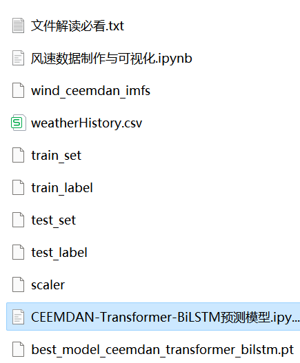
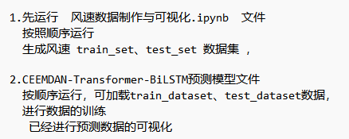

<!-- PAYMENT_BLOCK -->

## Get this dataset

- Payment link (Stripe): [Buy now](https://buy.stripe.com/3cs8yP7sY87d0vu9AB)
- Payment QR code: 

<!-- /PAYMENT_BLOCK -->
